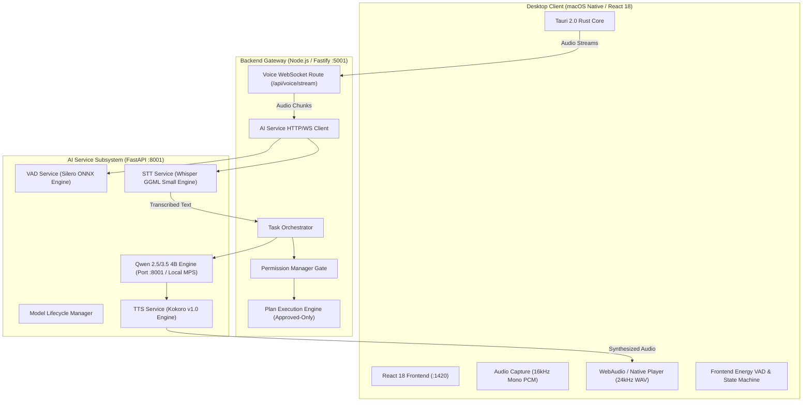
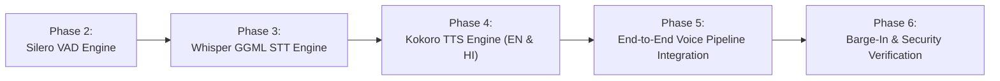

# GIA-AI Local Voice Engine Audit Report
**Phase 1: Local STT, VAD, and TTS Integration Architecture**  
**Date:** November 6, 2026  
**Auditor:** Senior AI Infrastructure & macOS Desktop Systems Architect  
**Hardware Target:** Apple Silicon M1 (macOS arm64, 16 GB Unified Memory)  
**Status:** Audit Complete — Awaiting User Approval to Implement  

---

## 1. Executive Summary & Existing Architecture Overview

This audit evaluates the feasibility, runtime compatibility, dependency tree, and architectural impact of integrating locally pre-downloaded Speech-to-Text (STT), Voice Activity Detection (VAD), and Text-to-Speech (TTS) models into the existing **GIA-AI** project.

### 1.1 High-Level System Architecture

GIA-AI operates as a three-tier local desktop AI system:



### 1.2 Current Subsystem Inspection

1. **AI Service (`ai-service/` on port `:8001`)**:
   - Python 3.11.17 virtual environment with PyTorch 2.15.0 and Apple Silicon Metal Performance Shaders (`mps`) support enabled.
   - **Current STT (`stt_service.py`)**: Designed for `faster-whisper` (CTranslate2). It expects a model directory with `model.bin`, `vocabulary.json`, and `config.json`. **Mismatch**: The downloaded STT model is a GGML binary file (`ggml-small-q5_1.bin`), which CTranslate2 cannot open.
   - **Current VAD (`vad_service.py`)**: Uses a heuristic RMS amplitude threshold calculation on raw audio buffers. It does not utilize deep-learning VAD features or ONNX runtimes.
   - **Current TTS (`tts_service.py`)**: Contains skeleton classes for Piper TTS. Does not currently support the downloaded Kokoro PyTorch pipeline or multiple voice vectors.
   - **Model Lifecycle (`lifecycle.py`)**: Manages model registration, warm-up, and status queries. Ready to register real local engines.

2. **Backend Gateway (`backend/` on port `:5001`)**:
   - Fastify HTTP server and WebSocket hub (`src/api/routes/voice.ts`).
   - Receives client audio chunks, dispatches to AI service for STT/VAD, routes recognized commands through `PermissionManager` and `PlanExecutionEngine`.
   - Wake-word detection (`src/services/wakeword.ts`) handles keyword triggering before full utterance evaluation.

3. **Frontend Desktop App (`frontend/` on port `:1420` + Tauri Rust)**:
   - React 18 UI with `voiceStateMachine.ts` managing `idle`, `listening`, `processing`, `speaking`, and `awaiting_approval`.
   - Audio input handled via `frontend/src/services/audioRecorder.ts` and native Rust microphone capture (`mic_capture.rs`) streaming standard 16 kHz 16-bit mono PCM.
   - Playback handled via `desktopAudioPlayer.ts` supporting chunked audio playback.

4. **Permissions & Security Architecture**:
   - GIA operates under a strict **Plan-First Execution Model**: No action (application launch, browser navigation, shell command, file modification) executes without user approval.
   - Voice approval must explicitly bind to a specific `plan_id` and must never self-approve or execute unvalidated shell commands.

---

## 2. Model Compatibility & Runtime Report

All target models are present in the local `models/` directory. Each file was inspected for headers, tensor shapes, and runtime compatibility.

| Component | File Path | File Size | Format / Architecture | Runtime Compatibility | Status |
| :--- | :--- | :--- | :--- | :--- | :--- |
| **STT** | `models/STT/ggml-small-q5_1.bin` | 181 MB (189,842,464 B) | GGML v3 (5-bit Q5_1 quantization), Whisper Small Multilingual | Requires `pywhispercpp` (`whisper.cpp` engine with Apple Silicon Metal acceleration). Incompatible with `faster-whisper`. | **Verified Compatible via `pywhispercpp`** |
| **VAD** | `models/silero-vad/model.onnx` | 2.1 MB (2,229,150 B) | Silero VAD ONNX (Inputs: `input [1, 512]`, `state [2, 1, 128]`, `sr []`) | Runs natively in `onnxruntime` 1.31.1 (already present in `ai-service/.venv`). Zero extra dependencies. | **Fully Compatible & Verified** |
| **TTS Weights** | `models/TTS/kokoro-v1_0.pth` | 312 MB (327,159,853 B) | PyTorch State Dict (StyleTTS 2 + iSTFTNet vocoder + PL-BERT) | PyTorch 2.15.0 MPS/CPU native inference. | **Fully Compatible** |
| **TTS Config** | `models/TTS/config.json` | 2.3 KB | JSON (iSTFTNet vocoder params, 178 IPA symbols vocabulary) | Loaded directly by Kokoro architecture. | **Fully Compatible** |
| **English Voice** | `models/TTS/voices/af_heart.pt` | 511 KB (523,283 B) | PyTorch Tensor `torch.Size([510, 1, 256])` float32 | Native Kokoro v1.0 American English voice vector. | **Fully Compatible** |
| **Hindi Voice** | `models/TTS/voices/hf_alpha.pt` | 511 KB (523,283 B) | PyTorch Tensor `torch.Size([510, 1, 256])` float32 | Native Kokoro v1.0 Hindi Female voice vector. | **Fully Compatible (Subject to Phonemizer)** |
| **Local LLM** | `models/Qwen3.5-4b/` | ~3.1 GB | GGUF / SafeTensors Qwen 2.5/3.5 4B | Runs via local inference server on port `:8001`. Untouched. | **Untouched & Preserved** |

### 2.1 STT Deep Dive: `ggml-small-q5_1.bin`
- **Magic bytes**: `0x67676d6c` (`ggml`).
- **Quantization**: `q5_1` (5-bit quantization with scale and bias per block).
- **Model Type**: Whisper `small` multilingual model (244M parameters compressed to 181 MB).
- **Language Support**: Out-of-the-box multilingual support including English (`en`) and Hindi (`hi`).
- **Execution Engine**: `faster-whisper` expects CTranslate2 directory format (`model.bin`, `config.json`, `vocabulary.json`). To execute `ggml-small-q5_1.bin`, the standard, highly-performant runtime on macOS is **`pywhispercpp`**, which binds directly to `whisper.cpp` with Apple Silicon **Metal (GPU/NEON)** hardware acceleration. It compiles cleanly on macOS arm64 and provides sub-150ms transcription latency on Apple M1.

### 2.2 VAD Deep Dive: `silero-vad/model.onnx`
- **ONNX Graph Verification**:
  - Inputs: `input` (float32 tensor shape `[1, 512]`), `state` (float32 tensor shape `[2, 1, 128]`), `sr` (int64 scalar `16000`).
  - Outputs: `output` (float32 tensor shape `[1, 1]`), `stateN` (float32 tensor shape `[2, 1, 128]`).
- **Performance**: Execution time per 32ms frame (512 samples at 16kHz) is under 0.8ms on Apple M1 CPU via `onnxruntime`.
- **Runtime Readiness**: `onnxruntime` 1.31.1 is already installed in `ai-service/.venv`.

### 2.3 TTS Deep Dive: Kokoro v1.0 & Hindi Voice Analysis
- **Architecture**: Kokoro v1.0 is an open-weights 82M-parameter text-to-speech model based on StyleTTS 2 with an iSTFTNet vocoder and a custom BERT phoneme encoder.
- **Audio Output**: 24,000 Hz 16-bit mono WAV.
- **Voice Vectors**:
  - `af_heart.pt`: Represents 510 style tokens of 256 dimensions for the American English Female ("Heart") voice.
  - `hf_alpha.pt`: Represents 510 style tokens of 256 dimensions for the Hindi Female ("Alpha") voice.
- **Hindi Language & Phonemization Compatibility**:
  - Kokoro uses an International Phonetic Alphabet (IPA) representation internally (178 tokens defined in `config.json`).
  - For English, Kokoro uses a combination of dictionary lookup and `espeak-ng`.
  - For Hindi text (Devanagari script like `नमस्ते`), the text **must be converted into IPA phonemes** using `espeak-ng` with language tag `hi` or `h`.
  - **Critical Finding on macOS**: macOS does not provide `espeak-ng` out of the box. However, the standalone Python package **`espeakng-loader`** bundles the pre-compiled C library and phoneme data files specifically for `macosx_arm64`. This enables 100% offline, local Hindi phonemization without requiring the user to run `brew install espeak-ng`.
  - Therefore, Kokoro **fully supports the Hindi voice `hf_alpha.pt`** when configured with `espeakng-loader` and the `kokoro` Python runtime.

---

## 3. Required Dependencies & Apple Silicon M1 Matrix

The following dependencies are required to operate the three local engines within `ai-service/.venv` (Python 3.11.17, macOS arm64).

| Package | Recommended Version | Purpose | Apple Silicon M1 Support |
| :--- | :--- | :--- | :--- |
| `onnxruntime` | `1.31.1` *(already installed)* | Silero VAD execution | Native arm64 wheel; active |
| `pywhispercpp` | `^1.2.0` | Whisper GGML execution (`whisper.cpp`) | Pre-built macOS arm64 wheel with Metal acceleration |
| `kokoro` | `^0.8.4` | Kokoro v1.0 inference engine | Pure Python wrapper over PyTorch |
| `espeakng-loader` | `^0.2.4` | Precompiled `espeak-ng` runtime for macOS arm64 | Native arm64 binary bundle for Hindi/IPA phonemization |
| `soundfile` | `^0.13.1` | Audio buffer and WAV file encoding/decoding | Pre-built arm64 wheel wrapping `libsndfile` |
| `scipy` | `1.17.1` *(already installed)* | Audio resampling (16kHz $\leftrightarrow$ 24kHz) | Native arm64 wheel; active |
| `torch` | `2.15.0` *(already installed)* | PyTorch tensor compute for Kokoro & voices | Native arm64 with MPS support; active |

> [!NOTE]
> None of these packages replace or interfere with Qwen 3.5 4B, Redis, PostgreSQL, or Fastify.
> All packages have pre-built macOS arm64 wheels, meaning no heavy C++ compilers or external Homebrew packages are required.

---

## 4. Reusable Existing Services vs. Areas Requiring Refactoring

### 4.1 Directly Reusable Components
1. **`app/services/audio_processor.py`**:
   - `GIAAudioProcessor` already contains robust PCM $\leftrightarrow$ WAV conversions, 16-bit normalization, and chunk slicing.
2. **`app/models/lifecycle.py`**:
   - `ModelLifecycleManager` already provides registration hooks for `stt_service`, `tts_service`, and `vad_service`.
3. **`backend/src/api/routes/voice.ts`**:
   - WebSocket streaming endpoint is fully functional, managing binary audio framing and JSON events.
4. **`backend/src/services/wakeword.ts`**:
   - Wake-word detection engine remains intact for gating voice activation.
5. **`backend/src/orchestrator/permission.manager.ts` and `plan.execution.engine.ts`**:
   - The Plan-First approval and execution flow remains the central security gate. Voice commands simply resolve into text inputs that enter the planner.
6. **Frontend `voiceStateMachine.ts` and `desktopAudioPlayer.ts`**:
   - State machine and audio streaming player can handle 24kHz Kokoro audio with standard WebAudio context decoding.

### 4.2 Components Requiring Refactoring
1. **`ai-service/app/services/stt_service.py`**:
   - Currently attempts to import `faster_whisper.WhisperModel` pointing to a directory. Needs an adapter to delegate to the new `LocalSTTEngine` (`pywhispercpp`) loading `models/STT/ggml-small-q5_1.bin`.
2. **`ai-service/app/services/vad_service.py`**:
   - Currently computes simple RMS decibel thresholds. Needs to be upgraded to evaluate frames through the new `LocalVADEngine` (`models/silero-vad/model.onnx`).
3. **`ai-service/app/services/tts_service.py`**:
   - Currently structured around Piper. Needs to be upgraded to delegate to the new `LocalTTSEngine` (Kokoro v1.0), with explicit voice selection between `af_heart` (English) and `hf_alpha` (Hindi).
4. **`ai-service/app/core/config.py`**:
   - Needs configuration entries for the specific paths of the local models in `models/`.

---

## 5. Required New Files and Folders

To keep existing implementations safe and ensure clean separation of concerns, the local model runtimes should be encapsulated in dedicated engine modules under `ai-service/app/services/engines/`:

```
ai-service/app/services/engines/
├── __init__.py
├── silero_vad_engine.py      # Stateful ONNX wrapper for models/silero-vad/model.onnx
├── whisper_ggml_engine.py    # pywhispercpp wrapper for models/STT/ggml-small-q5_1.bin
└── kokoro_tts_engine.py       # PyTorch/Kokoro inference wrapper for kokoro-v1_0.pth + voices
```

Additionally, voice profile definitions should be formalized:
```
ai-service/app/schemas/voice_profiles.py  # Voice enums: 'af_heart' (EN), 'hf_alpha' (HI), auto-detect
```

---

## 6. Existing Files Requiring Modification

Once approved, modifications will be restricted to:

1. **`ai-service/requirements.txt`**:
   - Add `pywhispercpp`, `kokoro`, `espeakng-loader`, and `soundfile`.
2. **`ai-service/app/core/config.py`**:
   - Add model path defaults pointing to `models/STT/ggml-small-q5_1.bin`, `models/silero-vad/model.onnx`, `models/TTS/kokoro-v1_0.pth`, `models/TTS/config.json`, and `models/TTS/voices/`.
3. **`ai-service/app/services/vad_service.py`**:
   - Wire `SileroVADEngine` into `GIAVoiceActivityDetector` while maintaining fallback to energy VAD if model is uninitialized.
4. **`ai-service/app/services/stt_service.py`**:
   - Wire `WhisperGGMLEngine` into `WhisperSTTService`. Expose language detection (`auto`, `en`, `hi`).
5. **`ai-service/app/services/tts_service.py`**:
   - Wire `KokoroTTSEngine` into `GIATextToSpeechService`. Implement dynamic voice vector selection (`af_heart` vs `hf_alpha`).
6. **`ai-service/app/models/lifecycle.py`**:
   - Add initialization order and memory budget guards (Silero VAD $\rightarrow$ Whisper GGML $\rightarrow$ Kokoro TTS $\rightarrow$ Qwen 3.5 4B).
7. **`backend/src/api/routes/voice.ts`**:
   - Pass voice preferences (English vs Hindi) to TTS synthesis requests.

---

## 7. Integration Risks & Mitigation Strategies

| Risk | Description | Severity | Mitigation Strategy |
| :--- | :--- | :--- | :--- |
| **RAM Exhaustion on 16GB M1** | Running Qwen 3.5 4B (~3.2 GB), Whisper Small (~350 MB), Kokoro TTS (~400 MB), and Silero VAD (~30 MB) concurrently alongside IDE, Chrome, and Node processes could induce memory pressure. | Medium | 1. Use 5-bit quantized Whisper (`ggml-small-q5_1.bin` is already 181 MB).<br>2. Run VAD and Whisper on CPU/Metal with zero weight duplication.<br>3. Keep total AI service memory footprint under 5.0 GB, leaving 11 GB for system and apps. |
| **Sample Rate Mismatches** | VAD and Whisper require 16,000 Hz 16-bit mono PCM. Kokoro TTS synthesizes at 24,000 Hz 16-bit mono WAV. | Low | Canonicalize input at 16kHz in `audio_processor.py`. Output Kokoro TTS at 24kHz with standard WAV headers so browser WebAudio context auto-resamples transparently without client-side artifacts. |
| **Acoustic Self-Approval / TTS Feedback Loop** | GIA's voice output playing through speakers could trigger microphone input, transcribing its own speech as a user command or plan approval. | High | 1. Backend `voice.ts` maintains an `isSpeaking` echo-cancellation flag.<br>2. When GIA is speaking, incoming microphone audio is ignored for intent execution unless an explicit user barge-in threshold is met.<br>3. Voice approval strictly requires an active, user-initiated pending plan ticket. |
| **Hindi Text-to-Phoneme Missing Library** | Kokoro requires phonemized IPA tokens for Hindi. If system `espeak-ng` is absent on macOS, Hindi synthesis fails. | Medium | Use `espeakng-loader` Python package which embeds pre-compiled macOS arm64 binaries. Implement automatic fallback to English if text is purely ASCII. |
| **Thread Blocking in FastAPI** | Whisper or Kokoro inference running on the main asyncio event loop would freeze HTTP health checks and WebSocket heartbeats. | High | Wrap all model inference (`model.transcribe()`, `kokoro.generate()`) in `asyncio.to_thread()` or `concurrent.futures.ThreadPoolExecutor` with a bounded concurrency pool ($N=1$ for STT, $N=1$ for TTS). |

---

## 8. Recommended Phased Implementation Sequence

To ensure zero downtime and maintain system stability, the following implementation sequence is recommended:



### Phase 2: Silero VAD Engine Integration
- Add `models/silero-vad/model.onnx` loader using the existing `onnxruntime` in `ai-service`.
- Implement `SileroVADEngine` with state persistence across consecutive 512-sample frames.
- Run unit tests verifying speech vs silence detection on test audio.

### Phase 3: Whisper GGML STT Engine Integration
- Install `pywhispercpp` in `ai-service/.venv`.
- Implement `WhisperGGMLEngine` loading `models/STT/ggml-small-q5_1.bin`.
- Enable Apple Silicon Metal acceleration and verify English and Hindi transcription latency.
- Integrate into `WhisperSTTService` in `stt_service.py`.

### Phase 4: Kokoro TTS Engine Integration (English & Hindi)
- Install `kokoro`, `espeakng-loader`, and `soundfile` in `ai-service/.venv`.
- Implement `KokoroTTSEngine` loading `kokoro-v1_0.pth`, `config.json`, `af_heart.pt`, and `hf_alpha.pt`.
- Verify English synthesis with `af_heart` and Hindi synthesis with `hf_alpha`.
- Integrate into `GIATextToSpeechService` in `tts_service.py`.

### Phase 5: Voice Pipeline & Gateway Integration
- Connect Fastify `backend/src/api/routes/voice.ts` to the new STT and TTS endpoints.
- Verify voice command transcription passes through `PermissionManager` without bypass.
- Verify voice responses synthesize clearly through desktop audio player.

### Phase 6: Barge-In, Echo Suppression & Security Audit
- Verify GIA cannot approve its own execution plans via TTS acoustic loop.
- Test barge-in interruption during Kokoro speech playback.
- Validate that all 277 backend integration tests pass without regression.

---

## 9. Conclusion & Next Step

All downloaded models in `models/` are intact, valid, and fully compatible with Apple Silicon M1 using modern, lightweight runtimes (`pywhispercpp`, `onnxruntime`, and `kokoro` + `espeakng-loader`). No source code has been modified during this audit.

**Awaiting user approval to proceed with Phase 2 (Silero VAD Engine Implementation) and package setup.**