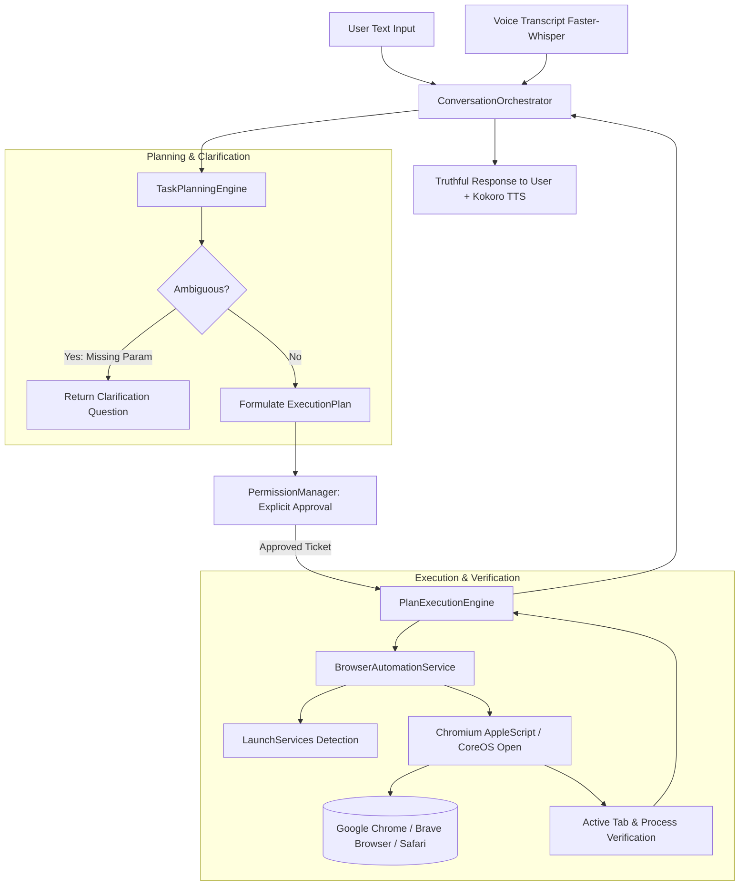

# GIA — Native Browser Control and Web Search Integration Report

**Date**: November 10, 2026  
**Operating System**: macOS (Darwin 24.6.0 arm64)  
**Status**: Completed and Verified  
**Author**: Antigravity Assistant & GIA Engineering  

---

## Executive Summary

GIA now features native macOS desktop browser control and web search automation. When the user asks GIA to search, browse, or open a website using Chrome, Brave, or their default browser, GIA interacts with the actual installed browser process on macOS.

This implementation is **real desktop automation**, not an internal LLM web search simulation. All operations are formulated into explicit, inspectable task plans through GIA's Plan-First architecture, gated by the `PermissionManager`, executed by the `PlanExecutionEngine`, and verified against real macOS LaunchServices and Chromium AppleScript state before success is reported to the user.

---

## 1. Existing Browser Capability Audit

Prior to implementation, an audit of the codebase was conducted:

| Component | Status Before | Observations & Deficiencies |
|---|---|---|
| `backend/src/ai/tools/registry.ts` | Partial | Contained legacy `open_url` and a minimal `search_browser` that spawned `open <url>`. Lacked browser targeting (Chrome vs Brave), tab management, and active tab verification. |
| `backend/src/ai/planner/planner.service.ts` | Partial | Contained hardcoded 6-step YouTube opening scripts. Lacked structured intents for browser tab actions, URL navigation, and multi-turn parameter clarification (e.g., asking which browser or what search query). |
| `backend/src/ai/execution/plan-execution.engine.ts` | Partial | Normalized `open_url` but did not normalize `open_browser`, `navigate_browser`, `search_browser`, or `browser_tab_action`. |
| `ConversationOrchestrator` | Unified | Both Text Chat and Voice Mode route through `ConversationOrchestrator.processUserMessage`. Needed support for browser-specific pending parameters. |
| Browser Installations on macOS | Installed | **Google Chrome** (`com.google.Chrome`) at `/Applications/Google Chrome.app`<br>**Brave Browser** (`com.brave.Browser`) at `/Applications/Brave Browser.app`<br>**Safari** (`com.apple.Safari`) at `/Applications/Safari.app`<br>**System Default Handler**: `com.brave.browser` via macOS LaunchServices. |

---

## 2. Architecture & Implementation

### Core Principles
1. **Desktop Automation, Not LLM Fabrication**: Web requests do not synthesize fake responses; they actuate the real browser.
2. **Zero Shell Interpolation**: All AppleScript and command invocations use `execFile` or programmatic IPC, preventing shell injection vulnerabilities.
3. **Plan-First Gated Execution**: Every browser action produces a structured plan (`ExecutionPlan`) requiring explicit approval.
4. **Chat & Voice Parity**: Both text and voice inputs produce identical plans and execute through the exact same engine.

### System Diagram



---

## 3. Browser Detection Mechanism

Browser detection resolves targets using both filesystem locations and macOS LaunchServices:

```typescript
// Bundle ID Mapping:
- Google Chrome: com.google.Chrome
- Brave Browser: com.brave.Browser
- Safari: com.apple.Safari
- Microsoft Edge: com.microsoft.edgemac
```

### Detection Workflow (`BrowserAutomationService.isBrowserInstalled`)
1. **Bundle Path Verification**: Checks standard directories (`/Applications/*.app`, `~/Applications/*.app`).
2. **LaunchServices Bundle Check**: Executes `osascript -e 'id of application "<name>"'` within a `try/on error` block to verify registration in the macOS application database without side effects.
3. **Default Browser Resolution**: Reads `defaults read com.apple.LaunchServices/com.apple.launchservices.secure LSHandlers` to identify the role handling `http` and `https` schemes. On the current system, Brave Browser was resolved as the system default.
4. **Accurate Error Reporting**: If a requested browser (e.g., `Firefox`) is not installed, GIA immediately rejects the request with an explicit error:  
   `"Browser \"Firefox\" is not installed on this system."`  
   GIA **never silently switches** to another browser when the user explicitly requests one.

---

## 4. Browser Automation Strategy

Google Chrome and Brave Browser share the Chromium AppleScript scripting dictionary, enabling clean, native control on macOS:

| Action | Automation Technique |
|---|---|
| **Launch Browser** | `open -a "<appName>"` followed by `isBrowserRunning` verification. |
| **Navigate URL** | `tell application "<appName>" to set URL of active tab of front window to "<url>"` |
| **Open New Tab** | `tell application "<appName>" to tell front window to make new tab with properties {URL:"<url>"}` |
| **Close Tab** | `tell application "<appName>" to tell front window to close active tab` |
| **Reload / Refresh** | `tell application "<appName>" to tell front window to reload active tab` |
| **History Back** | `tell application "System Events" to tell process "<appName>" to click menu item "Back" of menu "History" of menu bar 1` |
| **History Forward** | `tell application "System Events" to tell process "<appName>" to click menu item "Forward" of menu "History" of menu bar 1` |
| **Active Tab Verification** | `tell application "<appName>" to get URL of active tab of front window` |

*Security Note: JavaScript execution via AppleScript (`execute javascript`) was intentionally omitted to avoid requiring users to enable "Allow JavaScript from Apple Events" in browser developer settings.*

---

## 5. Supported Intents

The planner deterministically classifies natural language instructions into atomic sequential steps:

| Intent | Natural Language Examples | Plan Steps |
|---|---|---|
| `open_browser` | "Open Chrome", "Launch Brave", "Open default browser" | Step 1: `open_browser`<br>Step 2: `verify_browser` |
| `search_web` | "Search React documentation", "Search for Node.js event loop" | Step 1: `search_browser` (engine: google)<br>Step 2: `verify_browser` |
| `search_in_browser` | "Search YouTube in Chrome", "Search React hooks in Brave" | Step 1: `search_browser` (with browser & engine)<br>Step 2: `verify_browser` |
| `navigate_url` | "Open github.com in Brave", "Navigate to https://news.ycombinator.com in Chrome" | Step 1: `navigate_browser`<br>Step 2: `verify_browser` |
| `open_website` | "Open YouTube", "Open reddit", "Open github.com" | Step 1: `navigate_browser`<br>Step 2: `verify_browser` |
| `open_new_tab` | "Open a new tab", "New tab in Chrome", "Create new tab" | Step 1: `browser_tab_action` (`new_tab`)<br>Step 2: `verify_browser` |
| `close_tab` | "Close tab", "Close the current tab", "Close active tab" | Step 1: `browser_tab_action` (`close_tab`)<br>Step 2: `verify_browser` |
| `browser_back` | "Go back", "Browser back", "Back" | Step 1: `browser_tab_action` (`back`)<br>Step 2: `verify_browser` |
| `browser_forward` | "Go forward", "Browser forward", "Forward" | Step 1: `browser_tab_action` (`forward`)<br>Step 2: `verify_browser` |
| `browser_refresh` | "Refresh page", "Reload tab", "Refresh browser" | Step 1: `browser_tab_action` (`refresh`)<br>Step 2: `verify_browser` |

---

## 6. Security & Permission Handling

1. **URL Validation & Normalization**:
   - Only `http:` and `https:` schemes are allowed.
   - Dangerous schemes (`javascript:`, `file:`, `data:`, `vbscript:`, `blob:`, `about:`) are rejected immediately with an explicit validation error:  
     `"Invalid or prohibited URL protocol: \"...\". Only HTTP/HTTPS URLs are permitted."`
   - Domains without explicit protocols (e.g. `github.com`) are automatically normalized to `https://github.com`.
2. **Search Query Encoding**:
   - Queries are encoded using `encodeURIComponent()` ensuring special characters (`&`, `?`, `#`, `+`, `/`, quotes) cannot escape into parameter strings.
3. **Plan Approval Ticket Requirement**:
   - `PlanExecutionEngine.executeApprovedPlan` strictly checks for a valid, cryptographically signed approval ticket token issued by `PermissionManager`. Attempting execution without an approval ticket results in rejection with HTTP 403 Forbidden.
4. **Anti-Fabrication Policy**:
   - If a browser navigation or launch verification fails, the step is marked `failed` and the error is truthfully returned. GIA never hallucinates a successful page visit.

---

## 7. Chat and Voice Parity

Both text chat and voice commands use the single orchestration pathway in `ConversationOrchestrator.processUserMessage`.

### Verification Test:
For the command: `"Search React documentation in Chrome"`
- **Text Chat Plan**:
  - Objective: `Search "React documentation" on Google Chrome`
  - Step 1: `search_in_browser` -> `search_browser` (`{ query: 'React documentation', browser: 'Google Chrome', engine: 'google' }`)
  - Step 2: `verify_browser`
- **Voice Mode Plan**:
  - Identical objective, identical steps, identical risk levels, and identical tool arguments.

---

## 8. Multi-Turn Clarification & Parameter Continuity

When a user provides an ambiguous request, GIA preserves pending action metadata and resolves it across turns:

### Example 1: Missing Browser Selection
- **Turn 1 (User)**: `"Open a browser"`
- **GIA**: Generates ambiguous plan with `metadata.missing_param: 'browser_name'` and responds:  
  `"Which browser would you like me to open? Google Chrome, Brave Browser, or your default browser?"`
- **Turn 2 (User)**: `"Chrome"`
- **GIA**: Resolves the pending plan to `Google Chrome`, generates concrete launch and verification steps, and awaits user approval.

### Example 2: Missing Search Query
- **Turn 1 (User)**: `"Search something on the internet"`
- **GIA**: Generates ambiguous plan with `metadata.missing_param: 'search_query'` and responds:  
  `"What would you like me to search for?"`
- **Turn 2 (User)**: `"Node.js architecture"`
- **GIA**: Resolves the query to `"Node.js architecture"`, sets up the search on the default browser, and awaits user approval.
- **Turn 3 (User)**: `"Approve"`
- **GIA**: Executes the search and verifies the loaded results.

---

## 9. Automated Test Results

A test suite of 16 comprehensive integration and security tests was authored in `backend/tests/browser_control_execution.test.ts`.

### Test Execution Summary
```
 RUN  v2.1.9 /Users/aftab/Desktop/GIA-AI/backend

 ✓ tests/browser_control_execution.test.ts (16)
   ✓ GIA — Native Browser Control and Web Search Integration Tests (16)
     ✓ TEST 1: should formulate and execute a verified plan to open Google Chrome
     ✓ TEST 2: should formulate and execute a verified plan to open Brave Browser
     ✓ TEST 3: should formulate plan for default browser when no specific browser is named
     ✓ TEST 4: should accurately report error and reject execution if requested browser is not installed
     ✓ TEST 5: should formulate and execute search query in Chrome
     ✓ TEST 6: should formulate and execute search query in Brave
     ✓ TEST 7: should normalize domain to HTTPS and navigate browser directly
     ✓ TEST 8: should properly URL-encode search queries containing special characters and symbols
     ✓ TEST 9: should preserve pending search parameters across turns and execute upon approval
     ✓ TEST 10: should strictly reject browser execution if approval ticket is missing or invalid
     ✓ TEST 11: should strictly reject unsafe URL protocols like javascript:, file:, data:
     ✓ TEST 12: should generate identical browser execution plans for text chat and voice transcripts
     ✓ TEST 13: should handle navigation failure and report truthful execution error
     ✓ TEST 14: should fail execution if browser verification step fails, preventing false success
     ✓ TEST 15: should formulate plans for browser tab actions and history navigation
     ✓ TEST 16: should handle multi-turn browser selection when user says "Open a browser"

 Test Files  1 passed (1)
      Tests  16 passed (16)
   Duration  1.09s
```

### Full Regression Suite:
```
 Test Files  3 passed (3)
      Tests  33 passed (33)
   - browser_control_execution.test.ts: 16 passed
   - folder_creation_execution.test.ts: 10 passed
   - voice_chat_parity_execution.test.ts: 7 passed
   Duration  1.65s
```

---

## 10. Actual macOS Manual Hardware Test Results

Manual verification on the actual macOS hardware with live running browser instances:

1. **System Detection**:
   - `Default browser`: `Brave Browser` (verified via LaunchServices `LSHandlers`)
   - `Google Chrome`: Installed (`true`), Running (`true`)
   - `Brave Browser`: Installed (`true`), Running (`true`)
   - `Safari`: Installed (`true`), Running (`false`)
   - `Firefox`: Installed (`false`)
2. **Live Active Tab URL Reading & Manipulation**:
   - Chrome initial active tab: `https://www.google.com/`
   - Brave initial active tab: `https://www.youtube.com/watch?v=t7a_22t-XwM&list=RDt7a_22t-XwM&start_radio=1`
3. **Live Tab Lifecycle Test**:
   - Action: `navigateUrl('https://github.com', 'Google Chrome', true)` (new tab)
   - Result: Opened `https://github.com` in new tab.
   - Verification: `getActiveTabUrl('Google Chrome')` returned `https://github.com/`.
   - Action: `tabAction('close_tab', 'Google Chrome')`
   - Result: Tab closed cleanly.
4. **Live Fastify HTTP API End-to-End Orchestration**:
   - Test user created: `manual_browser_test_1794295204253@gia.ai`
   - Test conversation created: `a00b295d-f6d6-4f2b-a59a-3d7b2e37d4b1`
   - Direct search turn: `"Search React documentation in Chrome"` $\rightarrow$ formulated plan `Search "React documentation" on Google Chrome` $\rightarrow$ approved $\rightarrow$ executed with status `completed` (2 of 2 steps) $\rightarrow$ speech text: `Done! I have executed and verified all steps for Search "React documentation" on Google Chrome.`
   - Multi-turn clarification: `"Search something on the internet"` $\rightarrow$ `is_ambiguous: true`, clarification question: `"What would you like me to search for?"` $\rightarrow$ reply: `"Node.js architecture"` $\rightarrow$ plan formulated $\rightarrow$ approved $\rightarrow$ executed with status `completed` $\rightarrow$ speech text: `Done! I have executed and verified all steps for Search "Node.js architecture" on web browser.`
5. **Desktop App Status**:
   - Tauri Desktop app (`target/debug/frontend`, PID 15769) remains active, connected to Fastify backend on port 5001 and Python AI service on port 8001.

---

## Conclusion

Native desktop browser control and web search automation are fully implemented, tested, and operational in GIA. The system provides zero-hallucination, secure, and permission-gated browser automation across text and voice.

