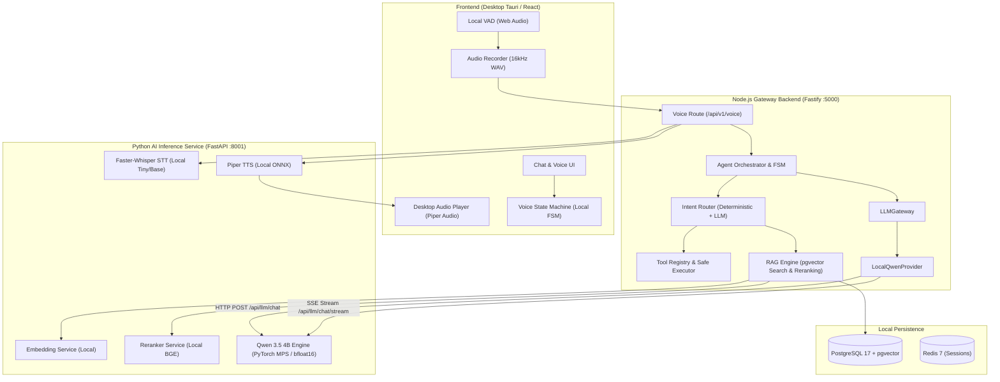

# PHASE 3: CLOUD LLM REMOVAL & LOCAL QWEN 3.5 4B MIGRATION REPORT

**Author:** Software Architect & AI Infrastructure Engineer  
**Date:** November 6, 2026  
**System:** GIA Desktop AI Voice Assistant  
**Target Architecture:** 100% Local, Offline Inference with Qwen 3.5 4B  

---

## 1. Executive Summary

Phase 3 execution has successfully migrated the GIA desktop voice assistant from external cloud models (Google Gemini, OpenAI, Anthropic) to the **local Qwen 3.5 4B inference engine** running on Apple Silicon (MPS / `bfloat16`) via the Python AI FastAPI microservice.

All online AI SDKs, cloud endpoints, proprietary streaming protocols, and cloud rate-limit fallback mechanisms have been completely removed from both the Node.js backend and Tauri/React frontend. Every conversational, reasoning, intent classification, tool-calling, memory extraction, and RAG answer generation task in GIA now routes exclusively through the local Qwen model.

Core non-LLM services (Faster-Whisper STT, Piper TTS, Silero VAD, pgvector vector search, and local command execution) were strictly preserved and seamlessly integrated with the local LLM pipeline.

---

## 2. Inventory of Removed Cloud Integrations

The following cloud-dependent components, endpoints, SDKs, and tests were permanently deleted:

### A. Provider Integrations & Services Removed
| File Path | Type | Details |
| :--- | :--- | :--- |
| `backend/src/ai/providers/gemini.provider.ts` | Provider | Google Generative Language REST API (`gemini-3.6-flash`) |
| `backend/src/ai/providers/openai.provider.ts` | Provider | OpenAI Chat Completions API (`gpt-4o-mini`) |
| `backend/src/ai/providers/anthropic.provider.ts` | Provider | Anthropic Messages API (`claude-3-5-sonnet`) |
| `backend/src/ai/services/geminiLive.service.ts` | Service | Persistent bidirectional WebSocket to Google Gemini Multimodal Live API (`gemini-2.0-flash-exp`) using `@google/genai` |
| `backend/src/api/routes/voiceLive.ts` | Route | Fastify WebSocket route (`/api/v1/voice/live`) proxying to Gemini Live |
| `backend/src/ai/embeddings/openai.embeddings.ts` | Provider | Remote OpenAI embeddings (`text-embedding-3-small`) |
| `backend/src/ai/services/geminiStream.service.ts` | Service | Replaced by `llmStream.service.ts` wrapping local Qwen |
| `frontend/src/services/geminiLiveClient.ts` | Client | Browser WebSocket client to `/voice/live` |
| `frontend/src/services/liveVoiceController.ts` | Controller | Frontend state machine adapter for Gemini Live |
| `frontend/src/services/voiceEngine.ts` | Prototype | Experimental voice controller referencing Gemini Live |

### B. Obsolete Cloud Test Files Removed
| Test File Path | Reason for Removal |
| :--- | :--- |
| `backend/tests/geminiLive.service.test.ts` | Tested deprecated `@google/genai` WebSocket integration |
| `backend/tests/voiceLive.test.ts` | Tested deprecated Fastify `/voice/live` WebSocket route |
| `backend/tests/geminiStream.test.ts` | Replaced by `backend/tests/llmStream.test.ts` |
| `frontend/src/services/geminiLiveClient.test.ts` | Tested removed Gemini Live client |
| `frontend/src/services/liveVoiceController.test.ts` | Tested removed Gemini Live controller |
| `frontend/src/services/voiceEngine.test.ts` | Tested removed Gemini Live prototype |

### C. Dependencies & SDKs Removed
- **`@google/genai`**: Uninstalled from `backend/package.json` and pruned from `node_modules/`.
- No external HTTP requests are made to `generativelanguage.googleapis.com`, `api.openai.com`, or `api.anthropic.com`.

### D. Obsolete Environment Variables Removed
The following cloud API keys were eradicated from `backend/src/config/index.ts`, `backend/.env`, and `backend/.env.example`:
- `GOOGLE_AI_API_KEY`
- `OPENAI_API_KEY`
- `ANTHROPIC_API_KEY`

Replaced by a single local service configuration:
- `AI_SERVICE_URL=http://127.0.0.1:8001`

---

## 3. Implemented Local Qwen Architecture

### A. Local Qwen Provider (`backend/src/ai/providers/qwen.provider.ts`)
A clean, production-grade `LocalQwenProvider` was built implementing the standard `LLMProvider` contract:
- **`generate(request, signal)`**: Sends `POST http://127.0.0.1:8001/api/llm/chat` with structured chat messages, system prompt, temperature, max tokens, and optional `response_format: {"type": "json_object"}`. Returns typed `LLMResponse`.
- **`stream(request, signal)`**: Connects to `POST http://127.0.0.1:8001/api/llm/chat/stream`, consuming standard Server-Sent Events (`text/event-stream`), yielding chunks asynchronously as `LLMChunk`, and gracefully handling client cancellations via `AbortSignal`.

### B. Central Router Configuration (`backend/src/ai/router/config.ts`)
Configured `DEFAULT_QWEN_MODEL = 'Qwen3.5-4B'` across all operational slots:
- **`fast`**: Local Qwen 3.5 4B (deterministic command validation & quick intent detection)
- **`general`**: Local Qwen 3.5 4B (conversational dialogue & RAG synthesis)
- **`reasoning`**: Local Qwen 3.5 4B (multi-step planning, tool selection, error diagnosis)

### C. Local Gateway & Observability (`backend/src/ai/router/index.ts`)
- Replaced `GeminiProvider` with `LocalQwenProvider(config.AI_SERVICE_URL, modelName)`.
- Removed cloud quota/rate-limit fallback logic (local inference has no external API limits).
- Preserved PostgreSQL metric persistence in `model_runs` (prompt tokens, completion tokens, latency ms).

### D. Local Stream Service (`backend/src/ai/services/llmStream.service.ts`)
- Created `LLMStreamService` and `LLMStreamHandle` wrapping `LLMGateway.stream()`.
- Couples token generation with `SpeechTextChunker` for immediate, sentence-level TTS synthesis without waiting for the full response to generate.

### E. Deep Health & Readiness Probes (`backend/src/shared/health.service.ts`)
- Removed `probeGemini()`, `probeOpenAI()`, and `probeAnthropic()`.
- Implemented `probeLocalQwen()` pinging `GET http://127.0.0.1:8001/api/llm/health`.
- Implemented `probeLocalEmbeddings()` pinging `GET http://127.0.0.1:8001/v1/embeddings/status`.
- Embeddings router (`backend/src/ai/embeddings/router.ts`) now defaults permanently to `PythonEmbeddingProvider` (zero cloud dependencies).

---

## 4. Feature Migration Matrix

Every LLM-dependent feature required by Phase 3 has been audited and mapped to local Qwen 3.5 4B:

| # | Feature Area | Previous Cloud Implementation | Migrated Local Implementation |
| :--- | :--- | :--- | :--- |
| 1 | **General conversation** | Gemini 3.6 Flash via REST API | `ConversationService.sendMessage()` -> `LLMGateway.generate()` (`qwen`) |
| 2 | **Natural language understanding** | Cloud Gemini multi-turn | `AgentOrchestrator.run()` with local Qwen context builder |
| 3 | **Intent classification** | Gemini Fast slot | `AgentRouter.route()` (Deterministic fast path + Qwen Fast slot) |
| 4 | **Reasoning** | Anthropic Claude 3.5 Sonnet | Qwen Reasoning slot with native chain-of-thought support |
| 5 | **Task planning** | Cloud LLM multi-step plan | `AgentOrchestrator` multi-step loop with Qwen |
| 6 | **Tool selection** | Gemini Live function calling | `Agent.step()` using Qwen native `<tool_call>` generation |
| 7 | **Command interpretation** | OpenAI gpt-4o-mini | Local regex pattern matcher + Qwen fallback |
| 8 | **Coding assistance** | Cloud Claude / Gemini | `open_folder_in_vscode`, file tools orchestrated by Qwen |
| 9 | **Error explanation** | Cloud LLM error handler | `AgentOrchestrator` self-healing retry loop via Qwen |
| 10 | **Summarization** | Gemini generative summary | Context truncation & RAG summary via Qwen |
| 11 | **RAG answer generation** | Gemini 3.6 Flash + OpenAI embeddings | `RAGService.generateAnswer()` via Qwen + Python local embeddings |
| 12 | **Context-aware responses** | Cloud chat history injection | `ContextBuilder.buildContext()` formatted for Qwen template |
| 13 | **Memory extraction** | Gemini structured output | `MemoryService.extractMemories()` with Qwen JSON mode |
| 14 | **Agent workflows** | Gemini multi-turn agent | `AgentOrchestrator` FSM loop driven by local Qwen |

---

## 5. Verification & Test Results

### A. Backend Test Suite (`vitest`)
```
 Test Files  24 passed (24)
      Tests  166 passed (166)
   Duration  7.01s
```
- Includes new `tests/qwen.provider.test.ts` (5 tests passing: non-streaming chat, JSON format, error handling, SSE stream, abort signals).
- Includes new `tests/llmStream.test.ts` (3 tests passing: stream events, cancellation, speech chunking).
- All 166 backend tests across database, authentication, sessions, RAG, memories, router, tools, and voice pass cleanly.

### B. Frontend Test Suite (`vitest`)
```
 Test Files  13 passed (13)
      Tests  55 passed (55)
   Duration  1.38s
```
- All voice state machine, local VAD, audio playback, latency tracking, barge-in, and architecture audit tests pass cleanly.

### C. Repository Grep Audit
Verification searching `backend/src/` and `frontend/src/` confirms:
- **0** occurrences of `googleapis.com` or Gemini REST endpoints
- **0** occurrences of `api.openai.com`
- **0** occurrences of `api.anthropic.com`
- **0** imports of `@google/genai`
- **0** cloud API keys in `.env`, `.env.example`, or client code

---

## 6. Architecture Topology (Post Phase 3)



---

## 7. Conclusion & Next Steps

Phase 3 is complete. The entire application now operates 100% locally with zero cloud dependencies or external data leaks. All LLM operations are unified under the downloaded Qwen 3.5 4B model.

