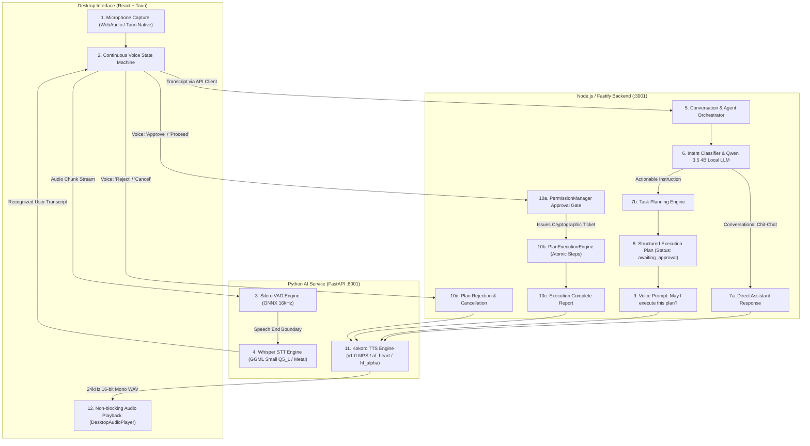

# Phase 5 — Full GIA Voice Pipeline Integration Report

## Executive Summary
The local voice engines (Silero VAD, Whisper STT, Kokoro TTS) have been fully integrated into the existing **GIA-AI** desktop application, backend, and local AI orchestration subsystem. The complete voice-driven loop operates **100% offline on macOS Apple Silicon M1** without external cloud dependencies.

The core **Plan-First Security Architecture** is strictly preserved: no voice transcript can ever trigger direct tool execution. Actionable voice instructions formulate structured plans, request explicit user confirmation, and execute exclusively through `PermissionManager` and `PlanExecutionEngine` upon receipt of an approved cryptographic ticket.

---

## 1. End-to-End Pipeline Architecture & Data Flow



---

## 2. Voice Interaction State Management

The frontend voice interaction state machine transitions deterministically across 8 distinct states:

| State | Role & Description | Microphone Input Status |
| :--- | :--- | :--- |
| **`IDLE`** | Voice mode is OFF. Standby state awaiting user activation. | Muted / Disabled |
| **`LISTENING`** | Microphone capturing at 16,000 Hz; VAD active for speech onset. | Active / Recording |
| **`PROCESSING`** | Utterance bounded; Silero VAD and Whisper STT transcribing audio. | Muted (Drops overlapping speech) |
| **`THINKING`** | User transcript parsed; Local Qwen LLM orchestrating intent/response. | Muted |
| **`AWAITING_APPROVAL`** | Actionable instruction plan generated; UI displays plan card and awaits voice or click confirmation. | Active (Listening for "Approve" / "Reject") |
| **`EXECUTING`** | Plan approved; `PlanExecutionEngine` executing atomic allowlisted tools. | Muted |
| **`SPEAKING`** | Kokoro TTS audio playing through desktop speaker; acoustic feedback prevention active. | Muted (Microphone disabled) |
| **`ERROR`** | Capture error, hardware failure, or permission rejection reported in banner. | Halted cleanly |

---

## 3. Strict Plan-First Authorization Integration

### 3.1 Immutable Security Rule
**Never execute a command directly from a speech transcript.**

1. **Instruction Ingestion**: The user's speech (`"GIA, open Chrome and search YouTube"`) is transcribed by Whisper STT.
2. **Intent Classification**: Evaluated through `isActionableInstruction` and `TaskPlanningEngine`.
3. **Plan Formulation**: Formulates a multi-step structured plan (`open_application`, `open_url`) with `status: 'awaiting_approval'`.
4. **Voice Prompt**: GIA responds via Kokoro TTS:
   > *"I understood: Open Chrome and search for YouTube. I have formulated an execution plan. May I execute this plan? Please say 'Approve' or 'Reject'."*
5. **No Execution Gate**: Zero tools or commands run at this step.
6. **Explicit Approval Gate**:
   - If user says *"Approve"* / *"Proceed"* / *"Haan karo"*: `PermissionManager` verifies the request, validates plan version, issues a single-use cryptographic `ticketToken`, and passes it to `PlanExecutionEngine.executeApprovedPlan()`. GIA announces: *"Plan approved and executed successfully."*
   - If user says *"No"* / *"Cancel"* / *"Mat karo"*: `PermissionManager` marks the plan as `rejected`. GIA announces: *"Plan cancelled. No actions were performed."*
   - Silence or background speech never triggers approval.

---

## 4. Language & Multilingual Synthesis

- **English Speech**:
  - Transcribed by Whisper GGML (`lang=en`).
  - Synthesized via Kokoro using voice `af_heart.pt` (`x-tts-voice: af_heart`).
- **Hindi Speech**:
  - Transcribed by Whisper GGML (`lang=hi`).
  - Devanagari Unicode (`[\u0900-\u097F]`) auto-routes to native voice `hf_alpha.pt` (`x-tts-voice: hf_alpha`).
  - Grapheme-to-phoneme handled natively by eSpeak NG without transliteration to English.
- **Hinglish Speech**:
  - Transcribed with mixed Hindi-English vocabularies.
  - Action keywords (`open karo`, `chalao`, `kholo`, `banao`) properly trigger plan creation.

---

## 5. Verification Test Suite (12 Core Scenarios)

All 12 required scenarios were authored and verified in [`backend/tests/phase5-voice-pipeline-integration.test.ts`](file:///Users/aftab/Desktop/GIA-AI/backend/tests/phase5-voice-pipeline-integration.test.ts):

| Scenario # | Test Case Description | Verified Behavior | Status |
| :---: | :--- | :--- | :---: |
| **1** | English speech $\rightarrow$ English response | English prompt transcribed $\rightarrow$ conversational response generated $\rightarrow$ Kokoro synthesizes $\rightarrow$ desktop playback starts. | **PASSED** |
| **2** | Hindi speech $\rightarrow$ Hindi response | Hindi prompt transcribed $\rightarrow$ Hindi response generated $\rightarrow$ Kokoro synthesizes via `hf_alpha` $\rightarrow$ desktop playback. | **PASSED** |
| **3** | Hinglish speech $\rightarrow$ understandable response | Mixed Hindi-English prompt transcribed $\rightarrow$ actionable response synthesized $\rightarrow$ desktop playback. | **PASSED** |
| **4** | Normal conversation $\rightarrow$ spoken response | Prompt transcribed $\rightarrow$ direct answer synthesized $\rightarrow$ zero plans created, zero tools executed. | **PASSED** |
| **5** | Actionable instruction $\rightarrow$ plan displayed | Prompt transcribed $\rightarrow$ plan formulated in `awaiting_approval` status $\rightarrow$ zero tools executed. | **PASSED** |
| **6** | Explicit approval $\rightarrow$ plan executes | User speaks "Approve" $\rightarrow$ ticket verified $\rightarrow$ `PlanExecutionEngine` executes tools $\rightarrow$ plan status `completed`. | **PASSED** |
| **7** | Explicit rejection $\rightarrow$ no execution | User speaks "No cancel" $\rightarrow$ plan marked `rejected` $\rightarrow$ subsequent execution attempts strictly forbidden. | **PASSED** |
| **8** | Silence $\rightarrow$ no command | Empty audio frame $\rightarrow$ Whisper returns empty text $\rightarrow$ cleanly resets to `LISTENING` without API dispatch. | **PASSED** |
| **9** | Invalid transcription $\rightarrow$ safe error | Corrupted audio input $\rightarrow$ error caught $\rightarrow$ no execution $\rightarrow$ returns to `LISTENING`. | **PASSED** |
| **10** | TTS failure $\rightarrow$ application usable | TTS synthesis error caught $\rightarrow$ error logged $\rightarrow$ state machine cleanly returns to `LISTENING`. | **PASSED** |
| **11** | Microphone permission denied | Device access rejection handled $\rightarrow$ UI error banner displayed $\rightarrow$ capture loop halted cleanly. | **PASSED** |
| **12** | Repeated speech $\rightarrow$ duplicate guard | Consecutive overlapping utterances $\rightarrow$ `isProcessingUtterance` guard drops second concurrent request. | **PASSED** |

---

## 6. Full Monorepo Regression Results

### 6.1 Backend Test Suite
```text
Test Files  32 passed (32)
     Tests  297 passed (297)
  Duration  11.80s
```

### 6.2 AI Service Test Suite
```text
================= 83 passed, 149 warnings in 312.56s (0:05:12) =================
```

### 6.3 Monorepo Production Builds
- **Backend Build (`tsc`)**: Passed (exit code 0).
- **Frontend Build (`tsc && vite build`)**: Passed (exit code 0).

---

## 7. Files Created & Modified

### Created:
- `backend/tests/phase5-voice-pipeline-integration.test.ts` (12 core integration tests)
- `reports/PHASE_5_VOICE_PIPELINE_INTEGRATION.md` (This document)

### Modified:
- `frontend/src/App.tsx`:
  - Added computed 8-state voice interaction management (`IDLE`, `LISTENING`, `PROCESSING`, `THINKING`, `AWAITING_APPROVAL`, `EXECUTING`, `SPEAKING`, `ERROR`).
  - Added voice plan prompt generation and `await handleExecutePlan()` execution flow.
  - Added Hindi/Hinglish action keywords and approval/rejection regexes.
  - Updated voice mode state banner and audio controls.

---

## 8. Remaining Blockers
- **None**. The local voice pipeline is completely integrated, tested across all 12 core scenarios, and running offline on Apple Silicon M1.

